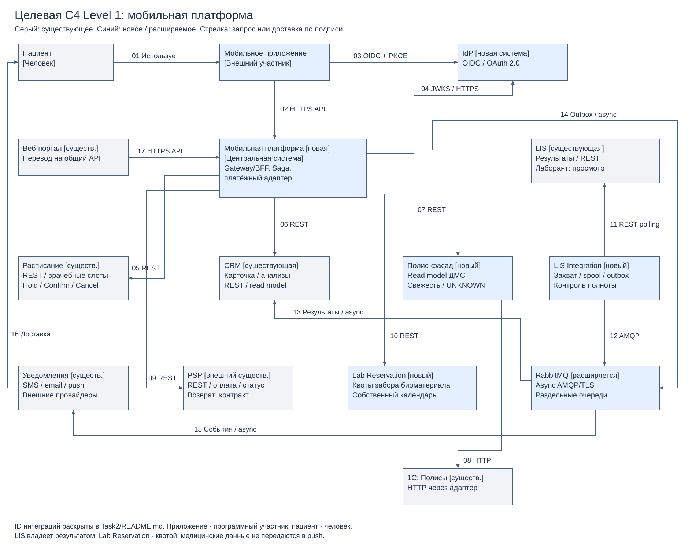

# 2. Целевая интеграционная архитектура

[Редактировать Draw.io](context.drawio) · [Векторный PDF](context.pdf).

Это C4 System Context: центральная система «Мобильная платформа» включает API Gateway/BFF, оркестратор и платёжный адаптер как внутреннюю реализацию; они перечислены в подписи, а не показаны самостоятельными контейнерами. Мобильное приложение показано внешним программным участником согласно формулировке задания; пациент остаётся человеком. Остальные блоки — соседние программные системы. Развёртывание и БД здесь не изображены. Номера на стрелках раскрыты в таблице.

Существующие Веб-портал, Расписание, CRM, LIS, 1С и Уведомления сохраняются. Существующий внешний PSP не заменяется. Добавляются Мобильная платформа, IdP, Полис-фасад, LIS Integration и Lab Reservation. RabbitMQ, уже применяемый для уведомлений, расширяется до управляемой событийной интеграции с изолированными очередями. Наличие существующего IdP не известно: новый IdP — проектное предложение.

| ID / поток | Стиль, протокол и обоснование |
|---|---|
| 01 Пациент → приложение; 02 Приложение → Мобильная платформа | HTTPS REST/JSON: короткие запросы чтения и команды с operationId; Gateway скрывает legacy, проверяет access token, лимитирует запросы. Создание записи идемпотентно в бизнес-сервисе, Gateway только передаёт ключ |
| 03 Приложение → IdP; 04 Платформа → IdP | OIDC Authorization Code + PKCE через системный браузер; платформа получает JWKS по HTTPS и проверяет JWT локально. IdP отделяет вход от медицинских сервисов |
| 05 Платформа → Расписание | REST-команды Hold/Confirm/Cancel и чтение слотов. Быстрая обратная связь по конфликтам; адаптация API существующей Java-системы, уникальный владелец doctor-slot и идемпотентные операции |
| 06 Платформа → CRM | REST: карточка пациента и результаты read model после авторизации; ответ не обращается синхронно в LIS. Привязка sub → patientId хранится на сервере и проверяется для каждого объекта |
| 07 Платформа → Полис-фасад; 08 Фасад → 1С | REST-чтение с состоянием свежести; фасад имеет локальную read model и ограниченный HTTP refresh к 1С. Anti-corruption layer нормализует null/503 в UNKNOWN, разгружает legacy; подробнее Task4.1 |
| 09 Платформа → PSP | REST только из backend payment adapter; платёжный intent фиксируется до отправки. Долгая оплата завершается в фоне, неизвестный результат сверяется по merchantOperationId. Приложение использует защищённую страницу PSP, реквизиты карты не проходят через платформу |
| 10 Платформа → Lab Reservation | Новые REST Hold/Confirm/Cancel по ресурсу lab-slot и operationId. Изолирует новый write-сценарий от LIS с описанными read-only ограничениями для лаборантов |
| 11 LIS Integration → LIS; 12 LIS Integration → RabbitMQ | Адаптер опрашивает доступный REST с watermark и сверкой, нормализует форматы и публикует событие через durable spool/outbox. Это сочетание legacy request/reply и событийной доставки, не заявленная готовая публикация событий из LIS |
| 13 RabbitMQ → CRM | Независимый consumer обновляет результаты транзакционно с inbox dedup. Async read model сглаживает пики и устраняет синхронную зависимость пациента от LIS |
| 14 Платформа → RabbitMQ; 15 RabbitMQ → Уведомления | Outbox события BookingConfirmed/ResultAvailable, отдельные очереди и подтверждения обработки. Уведомления выполняются после commit, их сбой не отменяет состоявшуюся запись |
| 16 Уведомления → Пациент | Внешние SMS/email/push провайдеры; только нейтральное сообщение о новом результате, без диагноза и токенов. Сам результат доступен после входа |
| 17 Веб-портал → Мобильная платформа | Целевой HTTPS API общий для веба и приложения: единые auth, лимиты, Saga и правила идемпотентности. Перевод портала выполняется постепенно; до переключения его существующие прямые вызовы сохраняются и используют те же ограничения уникальности/доступа в backend. Новый и старый канал не становятся двумя владельцами одного слота |

Операции не строятся единой цепочкой мобильный клиент → 1С → PSP → LIS. Команды Saga оркестрируются платформой с durable журналом, результаты и уведомления идут через брокер. Расписание владеет врачебным слотом, Lab Reservation — квотой забора, 1С — полисом, LIS — медицинским результатом, PSP — фактом списания, а локальный payment ledger — состоянием сверки с PSP.

Исходная C4 осмотрена: пациент/врач → Веб-портал; портал связан с Расписанием, PSP, Полисами, CRM и Уведомлениями; лаборант читает LIS; LIS передаёт результаты CRM; Уведомления доставляют сообщения пациенту. Вход оборудования по FTP сохраняется внутри лабораторного контура, не объявляется защищённым каналом к приложению. Для его замены и контроля потерь нужны отдельные мероприятия Task3.1.
