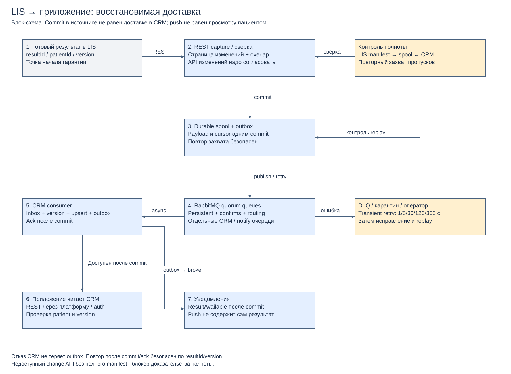

# 3.1. Надёжная доставка результатов

[Draw.io](data-flow.drawio) · [PDF](data-flow.pdf).

## Альтернативы

| Вариант и инструменты | Доставка / повторы | Задержка и пики | Эксплуатация / решение |
|---|---|---|---|
| Синхронный REST LIS → CRM → запрос приложения | Без журнала/повторов теряет результат при отказе; длинная цепочка связывает доступность | Низкая задержка при успехе; пик и отказ CRM давят на LIS | Простой happy path, сложное восстановление; отклонён как единственный механизм |
| Периодические XML/FTP-файлы | Manifest, checksum, журнал файлов и повторный импорт могут дать восстановление, но текущий процесс их не подтверждает | Пакетная задержка, повтор всего файла увеличивает нагрузку | Сохраняется временно только на входе оборудования; основной поток результатов на нём не строится |
| REST incremental polling → durable outbox → RabbitMQ quorum queues → CRM | At-least-once + publisher confirms + manual consumer ack; inbox/version dedup и reconciliation закрывают разрывы | Стартовый polling 5 с; consumer pool и backlog сглаживают всплески, очередь конечна | Выбран: RabbitMQ уже есть, REST LIS заявлен; нужны контракт изменений и эксплуатационные метрики |
| CDC → Kafka → проекция | Журнал изменений/replay эффективен, но требует доступного WAL/DB, ключей и корректной семантики результатов | Подходит для больших потоков и долгого replay | Доступ к БД LIS не задан, второй брокер усложняет MVP; отложен до доказанной потребности |

## Захват и гарантии

Источник истины — зафиксированный результат LIS с неизменным resultId, patientId, монотонной version и признаком готовности/отзыва. Адаптер запрашивает страницу изменений по `(updatedAt, resultId)` с перекрытием окна и устойчивой сортировкой, сохраняет raw payload, ключ и watermark одной транзакцией в локальный PostgreSQL spool. Watermark продвигается только после commit всей страницы. API с выборкой изменений — требуемое расширение, а не установленный факт о LIS: если его нельзя получить, интеграционный контракт должен предоставить полный индекс результатов с версиями для периодической сверки и более дорогого polling. Без обоих способов нельзя доказать полноту, и запуск доставки блокируется.

Из committed spool publisher отправляет persistent сообщения в durable exchange с mandatory routing в quorum queue CRM. Сырые события LIS не направляются уведомлениям: их отдельная очередь получает только ResultAvailable из committed CRM outbox. При unroutable/nack/timeout запись остаётся в outbox; повторы с backoff 1/5/30 с с jitter, затем 1 мин до восстановления. Publisher confirm относится к брокеру, не к CRM; при потере confirm возможен повтор. Три узла брокера в разных зонах обеспечивают большинство при одном отказе; потеря большинства останавливает публикацию, spool накапливает записи до восстановления.

CRM-consumer в одной транзакции вставляет inbox `(resultId,version)`, проверяет связь пациента, обновляет результат только при более новой version и создаёт outbox `ResultAvailable`. Ack брокеру даётся после commit. При падении между commit и ack повтор не создаёт новый результат. Изменённое содержимое с тем же ключом — конфликт, карантин и оператор; запоздалые старые версии игнорируются с аудитом, отзыв результата тоже версионируется. Inbox и контроль версий сохраняются не меньше горизонта replay, иначе старые сообщения нельзя безопасно переиграть.

Transient consumer failures: до 5 попыток через отдельные retry-очереди с задержками 1/5/30/120/300 с; без бесконечного requeue в горячий цикл. После исчерпания — DLQ с причиной, сигнал дежурному и контролируемый replay после исправления. Ошибка схемы, неизвестный patientId и конфликт версии сразу в карантин, не «успешно обработано». Доступ к payload ограничен, trace содержит только технические ID. TTL не удаляет неуспешные результаты без долговременной копии: исходная LIS и spool — основание восстановления, политика хранения согласуется до запуска.

Через CRM REST приложение читает committed результат с `resultVersion` и `updatedAt`; проверяются subject/patient и права на конкретный анализ. Push лишь сообщает «Доступен новый результат», не является доказательством получения данных пациентом. Недоставка push не скрывает результат из списка; фактическое открытие фиксируется отдельно без обязательности для завершения pipeline.

## Начало и конец надёжности

Ежедневная полная сверка manifest LIS `(resultId,version)` ↔ spool ↔ CRM и ежеминутная сверка последних изменений находят пропуски polling; mismatches создают задачи повторного захвата. Файлы оборудования → LIS требуют manifest количества/контрольной суммы, подтверждения импорта и сверки оборудования с LIS; если оборудование поддерживает только FTP, изолировать этот сегмент и поставить защищённый адаптер SFTP/TLS, не открывая FTP наружу. Схема гарантирует восстановимую доставку после commit LIS при сохранности источника, разрешённых контрактах и контроле capacity; глобального exactly-once и гарантии «пациент увидел push» нет.

Проектные критерии: P99 готовность LIS → доступность CRM <30 с в штатном режиме, polling ≤5 с, backlog age alarm >30 с, DLQ >0 — инцидент. Пауза CRM 15 мин с последующим replay должна закончиться без пропусков/дублей и с восстановлением согласованного lag. Начальный prefetch 20 на consumer, concurrency 4; менять по замерам БД. Ёмкость: `peak events/s × outage seconds × p95 message bytes × число очередей × коэффициент репликации`, плюс запас 50%; фактические входы неизвестны, число гигабайт не выдумывается. При заполнении spool/broker до 70% — alarm, до 85% — остановка необязательных публикаций и замедление захвата с сохранением cursor, без молчаливой потери.
