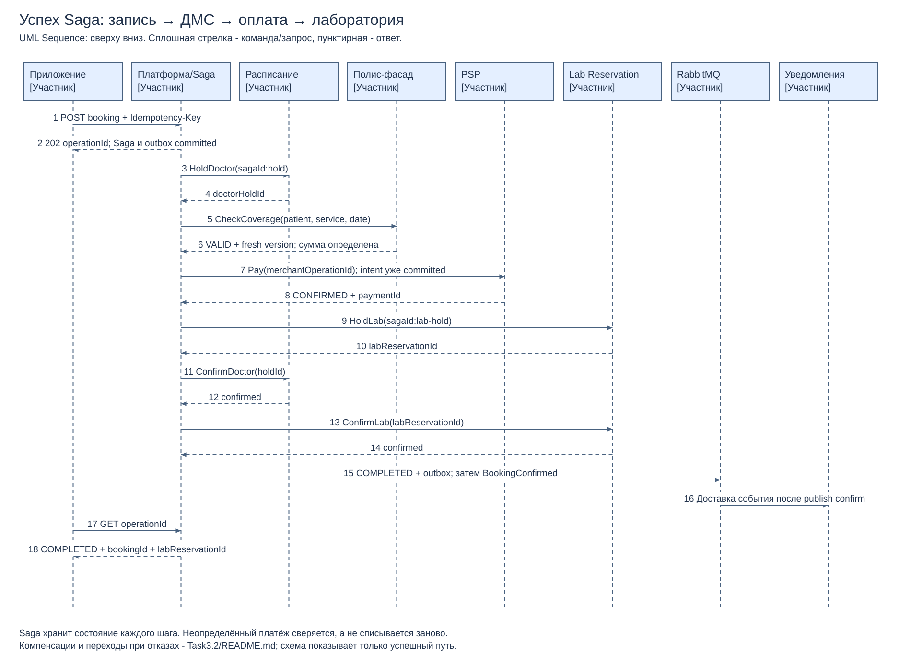

# 3.2. Запись, ДМС, оплата и лабораторный резерв

[Редактировать](success-sequence.drawio) · [PDF](success-sequence.pdf).

## Успешный сценарий

Пациент выбирает врача, услугу и лабораторную квоту; платформа проверяет доступ и атомарно принимает команду с ключом идемпотентности, возвращая 202/operationId. Оркестратор сохраняет Saga, удерживает слот врача, получает свежий VALID по ДМС для данного пациента/услуги/даты, создаёт платёжный intent и проводит оплату. После подтверждённой оплаты он удерживает лабораторную квоту, подтверждает оба резерва и фиксирует COMPLETED с outbox события уведомления. Клиент читает состояние операции, а уведомление доставляется независимо.

Для услуги с полным покрытием ДМС сумма к оплате равна нулю и платёжный шаг завершается NO_CHARGE; схема показывает платную/частично покрытую услугу. Размер оплаты рассчитывается сервером после проверки покрытия, клиентская сумма не является источником истины.

## Выбор Saga — четыре предложения

Выбрана оркестрационная Saga с устойчивым журналом состояний в PostgreSQL, поскольку последовательность записи, проверки ДМС, оплаты и лабораторного резерва должна быть явно контролируема. Центральный оркестратор знает correlationId каждого шага и может восстановить исполнение после перезапуска без распределённой транзакции. Для legacy и PSP проще предоставить ограниченные идемпотентные команды и сверку статуса, чем внедрить хореографию событий во все системы. Цена выбора — эксплуатация оркестратора, поэтому его реплики используют lease/fencing по Saga и не исполняют один шаг параллельно.

## Компенсации

| Шаг сценария | Компенсирующее действие | Устраняемый риск |
|---|---|---|
| Удержание / подтверждение слота врача | CancelHold/CancelBooking по исходному bookingId с ключом `sagaId:cancel-doctor`; автоматически освободить только неоплаченный hold после TTL | Занятый слот при неуспешной Saga; повтор компенсации не отменяет чужую запись |
| Подтверждённая оплата | Идемпотентный полный возврат по исходному paymentId (`sagaId:refund`), для preauth — void. До подтверждения результата возврата статус COMPENSATING и ручная эскалация, а не FAILED_FINAL | Деньги удержаны без оказанной услуги; нельзя считать компенсацию мгновенным rollback |
| Удержание / подтверждение лабораторной квоты | Release/Cancel по labReservationId с ключом `sagaId:cancel-lab`, затем компенсация оплаты и врачебного резерва | Утечка лабораторной ёмкости при сбое последующего confirm |

Проверка ДМС — чтение, компенсировать нечего; UNKNOWN не превращается в INVALID и останавливает следующий финансовый шаг. Если лабораторный резерв после оплаты не получен, возврат и освобождение врачебного слота выполняются с собственным durable retry. Отсутствующая лабораторная квота не подменяется «успешной» записью. Клинический сценарий без анализов — другая явно выбранная услуга, не молчаливый fallback.

## Состояния, неопределённость и восстановление

Состояния: ACCEPTED → DOCTOR_HELD → POLICY_VALID → PAYMENT_PENDING → PAYMENT_CONFIRMED → LAB_HELD → RESERVATIONS_CONFIRMED → COMPLETED; при сбоях — COMPENSATING → CANCELLED, при неизвестном финансовом результате — PAYMENT_UNKNOWN → RECONCILING. На каждом переходе атомарно сохраняются результат шага и следующая команда в outbox. Дедлайн удержания врача стартово 10 мин с продлением оркестратором; неизвестный платёж не даёт автоматически выпустить слот для новой продажи без проверки/компенсации. Если hold всё же истёк, опоздавший успешный PSP-ответ запускает возврат, а не воскрешает занятую другим пациентом запись.

Неизвестный результат платежа не равен отказу: оркестратор опрашивает статус PSP по merchantOperationId и сохраняет тот же intent. Повтор списания не допускается, пока результат не определён. Если PSP не поддерживает идемпотентное создание и поиск статуса по стабильному ID, автоматическая оплата в пилоте не запускается; нужен договорённый контракт или hosted flow с однозначной сверкой. Webhook не считается существующим: основная схема использует polling; при появлении webhook проверяются подпись, срок и dedup, событие только ускоряет сверку.

Lab Reservation — новая система с единственным владельцем квот; запись резервирования не записывается произвольным SOAP-вызовом в LIS. Календарь квот утверждает клиника, а импорт/администрирование и ограничения конкурентных каналов должны быть реализованы до пилота этой услуги. LIS продолжает владеть результатами анализов.

## Идемпотентность на входе и в шагах

Клиент генерирует UUID Idempotency-Key на одно намерение записи и сохраняет его до терминального результата; при сетевом повторе использует тот же ключ. На backend scope ключа `(authenticated subject, operation type, key)`; вычисляется hash нормализованного тела. В одной транзакции уникальная вставка ключа, Saga и outbox принимает команду; другая реплика читает существующий operationId. Тот же ключ с другим hash возвращает 409, выполняющийся запрос — тот же 202/status URL, завершённый — сохранённый ответ. Клиент не может подменить patientId через тело.

Хранить запись ключа не менее согласованного окна повторов (стартово 7 дней); после этого постоянная уникальность бизнес-идентификаторов и paymentIntent всё ещё запрещает повторный эффект. Новый случайный ключ при двойном нажатии сам по себе не помогает: Расписание атомарно запрещает две активные записи на doctor-slot и дубли одного намерения пациента/слота; Lab Reservation также атомарно проверяет квоту. Каждый шаг имеет детерминированный ключ `sagaId:step`, журнал результата на стороне исполнителя и локальную транзакцию изменения ресурса плюс результата. Rate limiting и Redis-lock не заменяют эти ограничения PostgreSQL.

Критерии: два конкурентных POST с одним ключом дают одну Saga; разные ключи на один слот дают один успех и конфликт; crash после PSP success до локального commit не вызывает второе списание; отказ lab после оплаты даёт подтверждённый возврат; падение во время компенсации возобновляет её после рестарта.
