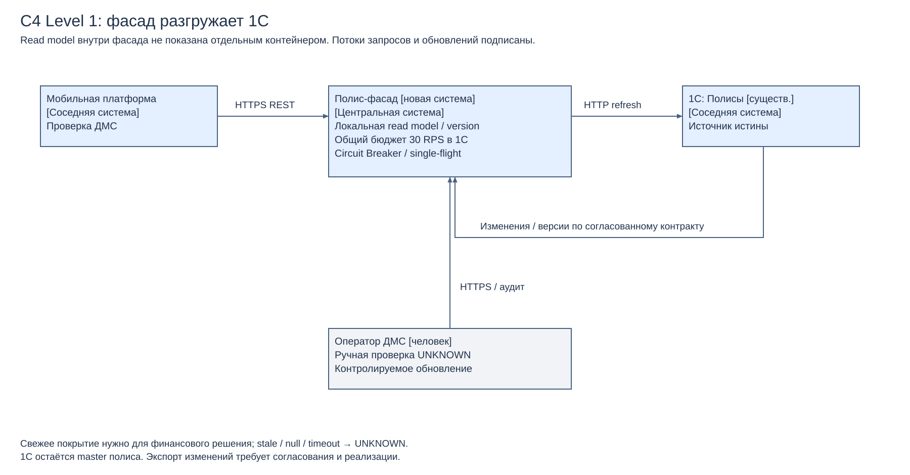

# 4.1. Отказоустойчивость и разгрузка 1С

Настройки ниже — проектные стартовые значения, а не измеренные характеристики. Тайм-аут ограничивает одно исходящее обращение, общий deadline и бюджет повторов ограничиваются отдельно. UI не ждёт всей Saga: командный API принимает её за <1 с и возвращает operationId.

| ИТ-система | Тайм-аут, секунды | Повторы и интервалы | Fallback и обоснование |
|---|---|---|---|
| 1С HTTP, чтение покрытия | connect 0.2; полный вызов 0.7; общий фоновой refresh deadline 1.8 | Всего 2 попытки, то есть 1 повтор, через 0.2 с + jitter 0–0.1 с, только при transient network/503 и закрытом breaker. Общая частота всех реплик ограничена 30 RPS, включая повторы | Свежий локальный ответ допустим по утверждённой политике. Просроченный/отсутствующий ответ, null или timeout → UNKNOWN, операция ожидает проверки; платёж ДМС не проводится как будто полис VALID. 30 RPS оставляет запас к известной зоне отказа >50 RPS |
| PSP, создание платежа | connect 0.5; полный вызов 2.0 в фоновом worker | По умолчанию 1 попытка списания. При подтверждённом PSP контракте идемпотентности допускается 1 повтор с тем же merchantOperationId через 1 с + jitter 0–0.3 с после проверки статуса; никогда новый ключ | Timeout → PAYMENT_UNKNOWN, долговременная сверка GET status, клиент видит «Платёж проверяется», новая оплата заблокирована. 2 с освобождают worker, не трактуются как доказательство отказа PSP |
| PSP, чтение статуса / возврат | GET status 1.0; refund 2.0 | GET status через 2/5/15/30 с, затем раз в 60 с; после 15 мин — операторская эскалация и фоновая сверка раз в 5 мин. Возврат повторяется с исходным refundId после сверки; для mutation без idempotency автоматического retry нет | Неизвестный результат не закрывается в FAILED. Периодическая сверка реестра PSP и ledger; дедлайн 15 мин — порог эскалации, не срок удаления долга |

Ошибки 4xx бизнес-валидации не повторяются. 429 учитывает Retry-After, не создаёт лавину retries. Для 1С, PSP и фоновых очередей отдельные connection pools, bulkheads и бюджеты потоков; сбой полисов не блокирует поиск врачей и чтение результатов.

## Приоритет Circuit Breaker: 1С

У 1С известна перегрузка >50 RPS и длительные зависания, поэтому breaker прежде всего защищает её от каскадной перегрузки и накопления потоков. Стартово CLOSED считает timeout/network/5xx, но не INVALID/4xx; после минимум 20 вызовов за скользящие 10 с и ≥50% технических ошибок открывает цепь на 30 с. OPEN не вызывает 1С, возвращает read model/UNKNOWN; HALF_OPEN допускает глобально не более двух проб, две успешные подряд закрывают цепь, любая техническая ошибка открывает снова. Бюджет 30 RPS общий для кластера фасада, а breaker сам по себе не является rate limiter; конфигурация и сигналы общие либо делятся по репликам консервативно.

PSP также имеет отдельный breaker для новых вызовов, но его открытие не меняет уже отправленные платежи на FAILED и не останавливает отдельный малый пул сверки статуса. Нужны alarms по OPEN duration, UNKNOWN age, числу pending/refund и расхождениям ledger/PSP.

## Одно архитектурное решение для разгрузки 1С: Полис-фасад с read model

[Draw.io](policy-context.drawio) · [PDF](policy-context.pdf).

Новая соседняя система Полис-фасад отвечает на запросы из локальной версионированной read model, а не вызывает 1С на каждый поиск/показ экрана. 1С остаётся источником истины по полисам; локальная копия содержит только нужные поля и ключ `(patientId, policyId, serviceCode, serviceDate)` для проверки покрытия, `sourceVersion`, `checkedAt`, `validUntil`. Данные шифруются, доступ строго служебный, Redis не требуется как единственное хранилище.

В MVP фасад выполняет инкрементальный refresh через согласованный HTTP экспорт 1С, стартово каждые 60 с, с журналом cursor и суточной полной сверкой. Такой экспорт/поля версии необходимо согласовать и реализовать, они не объявляются готовыми. Одинаковые refresh-запросы объединяются (single-flight); общий лимит 30 RPS включает фон, проверки и retries. При отсутствии change feed допускается batch-экспорт с теми же версиями, но его окно свежести должно пройти бизнес-согласование.

Для чтения карточки полиса стартово допустима копия до 5 мин с явным checkedAt. Для принятия обязательств по ДМС необходим ответ не старше 60 с на нужную услугу/дату, а при превышении — ограниченная авторитетная перепроверка в 1С; без неё UNKNOWN и ожидание/ручная проверка. Эти окна предложены и до запуска утверждаются владельцем ДМС; stale copy не служит основанием финансового решения. При невозможности согласовать безопасную read model этот сценарий не включается, а поиск и платная запись продолжают работать отдельно.

Эффект: при `R` проверках/с и доле попаданий `h` внешний поток примерно `R × (1-h) + background`, но actual h нужно измерить. Например, при условных R=200 и h=0.9 остаётся 20 RPS плюс фон в пределах общего лимита 30. Это пример оценки, не характеристика клиник.
