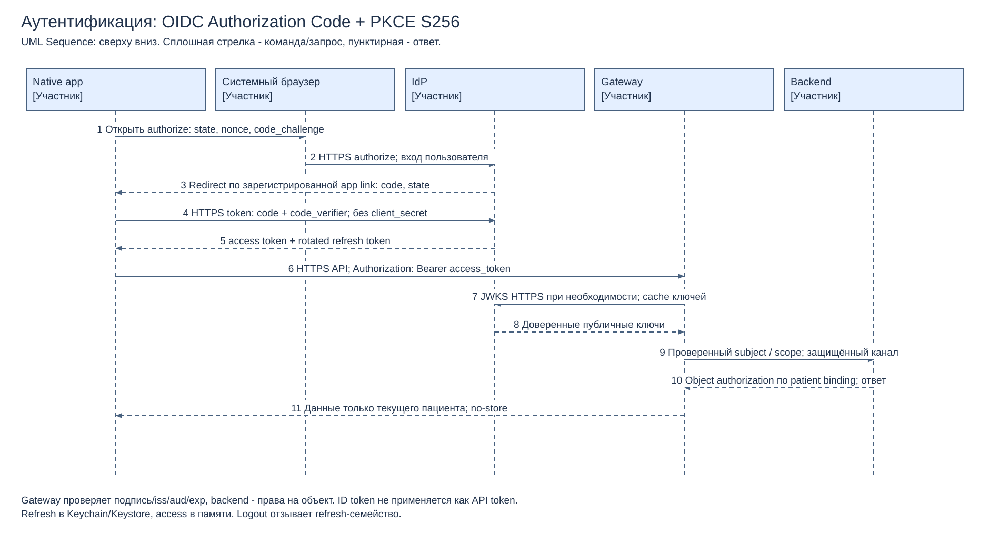

# 4.3. Аутентификация и безопасные интеграции

[Draw.io](authentication.drawio) · [PDF](authentication.pdf).

## Протокол и токены

OIDC поверх OAuth 2.0 Authorization Code + PKCE S256 для native public client: вход только через системный браузер, без client_secret в приложении. Redirect — зарегистрированная HTTPS universal/app link, точное совпадение URI, одноразовые state/nonce, code_verifier хранится только на устройстве до обмена. IdP аутентифицирует пациента, для чувствительных действий применяет дополнительный фактор согласно политике клиники. Способ подтверждения личности при первичной привязке к медицинской карте требует отдельного процесса: нельзя связать карту только по введённому ФИО/телефону без проверки.

Access token передаётся в `Authorization: Bearer <token>` по HTTPS, не в URL и не в push. Проектный срок access token 5 мин, refresh token 14 дней с ротацией и обнаружением повторного использования; refresh хранится в Keychain/Keystore, access — в памяти. При выходе/компрометации refresh-семейство отзывается; для срочной блокировки access tokens используется короткий TTL и серверная denylist/версия сессии. Значения сроков согласуются с моделью угроз, это предложения.

Gateway проверяет подпись по разрешённым алгоритмам и доверенным JWKS, issuer, audience, exp/nbf и scope, а backend повторно применяет проверку полномочий. ID token не используется для вызовов API. Сопоставление `sub → patientId` хранится сервером; `/appointments` всегда возвращает данные текущего пациента и не принимает произвольный patientId. Врачи/сотрудники используют отдельные роли и контекст доступа; на каждом objectId проверяются назначение/клиника/согласие, чтобы закрыть SD-007 независимо от причины инцидента. Неизвестный kid допускает ограниченный refresh JWKS, затем отказ; при недоступном IdP нельзя принимать непроверенный токен.

## Политика rate limiting

Стартовые лимиты — проектная гипотеза по типичному ручному использованию, измеряются на пилоте. Token bucket общий для всех Gateway-реплик; ограничения по пользователю и IP применяются совместно, IP лишь дополнительный признак из доверенного edge. Лимиты фоновых PSP/1С задаются отдельно и не расходуют пользовательский bucket.

| Тип запроса | Лимит | Действие при превышении |
|---|---|---|
| Публичный GET «Поиск врачей» | На IP refill 30/мин, burst 10; для клиник за общим NAT после анализа abuse допускается отдельная квота. Общий endpoint budget — измеренный safe RPS, по профилю нагрузки | 429 + Retry-After в секундах и requestId, без обращения к backend. Кеширование обезличенного каталога, challenge/временная блокировка при устойчивом abuse; лимит не делает endpoint авторизованным |
| Авторизованный POST «Создание записи» | На sub refill 5/мин, burst 2; дополнительный IP refill 60/мин, burst 10; бизнес-ограничения активных hold отдельно | 429 + Retry-After; клиент повторяет после ожидания с **тем же** Idempotency-Key. После auth lookup уже принятого ключа может вернуть существующую операцию без повторного бизнес-эффекта в отдельном ограниченном status bucket |

5 созданий в минуту существенно больше обычного ручного сценария; 30 поисков в минуту допускают смену фильтров, но не массовый scraper. Общий IP — возможные ложные срабатывания, поэтому политика уточняется по пилоту, не поднимается бесконтрольно. Недоступность распределённого limiter: POST fail-closed с 503 и Retry-After (не 429), публичный поиск — ограниченный локальный аварийный лимит с суммарным бюджетом, мониторингом и cache; обход auth невозможен. Rate limiting не заменяет идемпотентность и квоты doctor-slot.

## Защита каналов и данных

1. App → edge/IdP/PSP: HTTPS TLS 1.2/1.3, проверка hostname/цепочки сертификатов; production запрещает cleartext и отключение TLS verification. Certificate pinning — только при управляемой ротации и backup pins, не обязательное средство с риском самоблокировки.
2. Межсервисные REST, брокер и БД: TLS, при поддержке mTLS с удостоверениями сервисов, узкие network policies и egress allowlist. Legacy 1С/LIS за адаптером в закрытом сегменте; защищённый туннель до границы legacy, наружный HTTP/FTP не публикуется. До включения потока документируется остаточный участок без шифрования и план устранения; при невозможности защитить медицинский поток он не запускается.
3. Минимальные service accounts и scopes; секреты только в secret manager, ротация, запрет статических общих паролей в репозитории/мобильном клиенте. Внешний PSP получает только необходимые параметры операции, карта вводится на стороне PSP; требования платёжной интеграции уточняются отдельно.
4. Подпись/аутентификация источников, защита от replay через nonce/eventId/version и идемпотентность. Если появится PSP webhook, проверяются подпись, timestamp и eventId, сумма/валюта сверяются с intent, затем статус подтверждается у PSP. Клиентский «успех оплаты» не доказательство списания.
5. Параметризованные SQL вместо конкатенации, allowlist полей сортировки, ограничения длины/типа и schema validation XML/JSON, запрет XML external entities; minimal DB privileges. WAF только дополнительная защита INT-006.
6. Без медицинских данных/токенов/карт в URL, логах, tracing и push; тела анализов не идут в события уведомлений. `Cache-Control: no-store` для ответов пациента, запрет общего CDN cache для них. Шифрование локальных хранилищ/backup с раздельным доступом к ключам, ограниченный аудит чтения и изменений.
7. Сквозные traceId/operationId без ПДн, аудит доступа и смены ролей, alerts по BOLA, повторным refresh, аномальным возвратам/429. Security-тесты: чужой objectId, подменённый sub/patientId, истёкший/чужой audience JWT, SQL/XXE payload, повтор команды и утечка в логи.

Это техническая схема защиты, не юридическое заключение. Состав согласий, места хранения и нормативные обязанности сети требуют отдельного согласования с ответственными до промышленного запуска.
